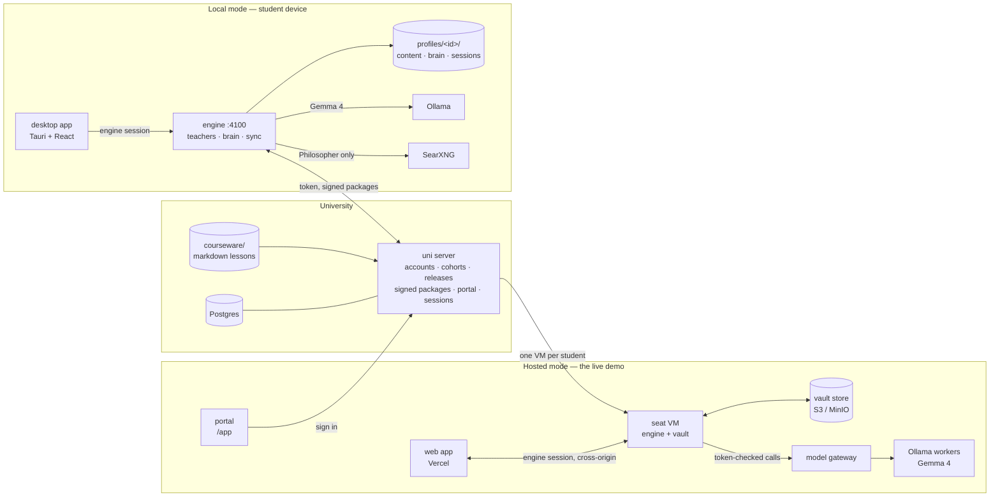

# Saint Elms Fire

## Reimagining learning and knowledge management in the age of AI

Saint Elms Fire is the university of the future. It gives every student their own personal teacher with three minds:

- *Socrates my Friend* is a buddy who knows your logistics and deadlines.
- *Socrates my Guide* knows the syllabus inside out.
- *Socrates my Philosopher* challenges you to apply your knowledge to shape the world.

Together, they teach from a living map of your personal learning journey. Every concept you touch becomes a star, and the constellation of your knowledge grows with you over the course.

Designed around GDPR/DPDP-style data minimisation — a technical posture, not a legal certification — the open-weight models do the work, and the second brain is a plain markdown vault that stays the student's own. Run it fully on the student's device (offline-first), or let the university host each student a private workspace — the vault is exportable byte for byte either way.

**In technical terms:** an offline-first study companion with three Socratic AI teachers on Gemma 4 and a second brain that maps what *you* understand onto the course sky — runnable on a student laptop, or as per-student hosted workspaces behind a university portal.

Submission for [Hacktoberfest Hack Day Bengaluru 2026](https://www.mlh.com/events/hacktoberfest-hack-day-bengaluru-a0), October 13–18, 2026 — **Track 1: Best Use of Gemma 4 → G3. Multimodal AI Intelligence** (*"combines information such as text, images or audio to understand context and produce meaningful outcomes"*).

**Team The Org of Fine & Curious Individuals:** [Mahesh Shantaram](https://github.com/thecont1/), [Leharaditya Kumar](https://github.com/Larry8668)

---

## See it live

| What | Where |
| --- | --- |
| Portal — sign in, open your workspace | <https://sef-uni.onrender.com/app> |
| Web app — the student workspace itself | <https://saint-elms-fire.vercel.app> |
| Uni API health | <https://sef-uni.onrender.com/health> |

These are the configured demo entry points; repository updates and deployed revisions are separate.

On a self-serve demo build, choose a student under **Try the demo**. The portal opens that persona's workspace, signs in there and starts the guided tour. Close it with × or Esc; **Tour** above Settings restarts it. If self-serve is disabled, use **Sign in as a demo student**, enter the operator-provided password, then **Open my workspace** and sign in on that engine.

The three personas share the same B.Sc. Physics/Maths/Astrophysics programme at different stages. Each persona has a persistent workspace shared by everyone trying that persona; individual browsers have separate engine sessions. A self-serve build embeds the demo password in the public portal bundle on purpose — it is only ever the demo credential (see [docs/deploy-vercel.md](docs/deploy-vercel.md)).

| | Ananya | Brinda | Chetna |
| --- | --- | --- | --- |
| Stage | Semester 1, week 6 | End of Semester 3 | Semester 5, thesis prep |
| Sky | Early course concepts and open misconceptions | Dense course sky with student-made connections | Advanced concepts, syntheses and research questions |
| Story | Mechanics half done; textbook misconceptions open in amber | Strong and well connected; her own physics → maths links | Research mode: Philosopher trails, peer links, a self-correcting misconception |

The hosted demo supports peer sharing when demo admission rows are seeded in Postgres. Each persona is in a different cohort, so switching personas does not show the same feed. Video **files** are supported: the engine combines audio transcription with sampled slide/board frames. YouTube links can be blocked on datacenter IPs; upload an audio or video file instead.

How the hosted path works: the portal sign-in asks the uni for the student's workspace → the uni spawns (or resumes) a **per-student VM** from a golden snapshot → the VM restores the student's vault from the object store → the browser is handed to the web app, which drives that VM cross-origin → every model call goes through a token-checked **model gateway** in front of the Ollama workers. The hosted app requests a final vault flush and workspace end on sign-out. Ordinary workspaces are retired; configured pinned demo workspaces remain. Engine logout revokes the calling device's session and retains shared credentials while another device is signed in.

## The idea in one minute

A university releases its courseware as signed packages. A student's engine installs only what has been released to their cohort, and from then on everything runs against that engine — on their laptop, or on their own hosted workspace:

- **Three teachers** with distinct contracts:
  - **Friend** answers campus questions (fees, hostels, calendars) from the university's support notes and the student's *confirmed* logistics only, and refuses to share other students' details — the refusal check runs before the model does.
  - **Guide** is a Socratic tutor that teaches only from the student's released lessons and probes their known misconceptions.
  - **Philosopher** starts from a committed, course-linked page of the student's wiki and explores real-world applications and recent developments. The app enables web search on every Philosopher turn; the anchor bar shows the topic query. Answers distinguish `[course]` and `[web]` evidence and end with a `Trailhead:` question. Without search, it falls back to course evidence.
- **A second brain**: one markdown page per concept *as the student understands it* — a plain folder you can open in Obsidian. Models only ever *propose* page edits; a deterministic compiler and merge policy decide what lands, model-drafted edits wait for the student's review of a diff, and mastery (met / shaky / solid) is computed from evidence, never set by the model.
- **The Brain view**: a full-screen, interactive map of the student's wiki, with search, growth replay and **Ask your brain**. Ask answers from that wiki alone, highlights cited pages and can save an answer through proposal review. Scroll down for **What your brain learned**, disagreements, page provenance, sources and maintenance.
- **The sky**: a star map of every concept in the released courses plus the student's own syntheses and questions. Stars light up as the brain grows: amber for shaky, gold for solid, aurora lines for connections the student made themselves.
- **Add to my wiki**: any evidence becomes a source — pasted or written notes, a PDF, a photo of handwritten notes (read by the vision model on upload), a voice memo or lecture recording, an uploaded lecture video, or a consented YouTube fetch (video sites can block datacenter IPs — upload the file instead). Audio and video are read in the background. Video combines audio transcription with sampled slide/board frames, merged on timestamps. Extractions can be corrected; any proposed page changes wait for explicit review.
- **Peers**: publish a page to your cohort's feed; importing a share runs the same source → proposal → review pipeline, never a direct write. An advisory safety screen flags risky payloads — the student still decides.
- **Proactive, within limits**: an attention rail, suggested questions from recent work, bounded study plans and consented subject feeds — all derived from the student's own stores, no silent writes.
- **A registrar's desk** hosted by the university itself at `/admin`: applications in, enrolment decisions out, every staff action audited.

With local model providers, the engine, brain and installed courseware can keep working without a network. Local sign-in uses cached password verification or a retained signed entitlement, depending on the account flow ([HANDOVER.md](HANDOVER.md) §6). Hosted mode needs the network; a limited session still permits reads and vault export.

## Run locally

You'll need Node 22+, pnpm 10.18 (the version pinned in `package.json`; `corepack` provides it) and Ollama running. Docker is optional — it runs SearXNG for web search or the container stack. Audio and video files need ffmpeg; YouTube links additionally need yt-dlp and Python 3.

```bash
corepack enable
pnpm install
cp .env.example .env     # first setup only; preserve an existing .env
pnpm ollama:pull         # gemma4:e4b + embeddinggemma + shieldgemma:2b
pnpm search:up           # optional: SearXNG web search for the Philosopher (Docker)
pnpm dev                 # uni server :4200, engine :4100, desktop UI :5173
```

Open <http://localhost:5173>. The default local demo password is **`harbor-lantern`** (overridable with `DEMO_PASSWORD`).

The engine and the Vite UI read the root `.env`; the uni server's dev script reads the host process environment, so export uni settings (for example a custom `DEMO_PASSWORD`) in the shell that starts it. This quickstart is the no-database demo — real accounts, the staff portal and Peers need Postgres; the bootstrap is in [HANDOVER.md](HANDOVER.md) §4.

| Account | Who | What to look at |
| --- | --- | --- |
| `ananya@saintelms.local` | Semester 1, week 6 | Small sky, Mechanics half lit, open misconceptions in amber (force vs. motion, centrifugal force, μN friction) |
| `brinda@saintelms.local` | End of Semester 3 | Dense, mostly gold sky; her own links from physics to the maths underneath (F = dp/dt → derivative) |
| `chetna@saintelms.local` | Semester 5, thesis prep | Near-complete sky, Philosopher research trails, peer links, one self-correcting shaky node (band gap) |

Staff sign in at the registrar portal the uni hosts itself (`http://localhost:4200/admin`). It needs the Postgres account stack rather than the local demo setup — the exact bootstrap commands are in [HANDOVER.md](HANDOVER.md) §4.

Compare the three students on the same **Mechanics** course to see how one curriculum grows into three different brains.

**Offline test (local cached password):** sign in once with everything running, then stop only the uni process — run `pnpm dev:uni`, `pnpm dev:engine` and `pnpm dev:app` in separate terminals, since stopping the combined `pnpm dev` stops all three — and keep the engine and Ollama up. Sign out and sign back in with the password: courses, chat and the brain still work; web search, Peers and course sync need their services. Device-authorized real accounts use a signed offline entitlement instead; explicitly signing out of the last device clears it — [HANDOVER.md](HANDOVER.md) §6.

Full setup, demo script and troubleshooting are in **[HANDOVER.md](HANDOVER.md)**. Coding agents start at **[AGENTS.md](AGENTS.md)**. Deep dives:

- **[docs/agentic-layer.md](docs/agentic-layer.md)**: the teachers, their tools, the chat-turn harness, source attribution, chat history and model providers.
- **[docs/knowledge-graph.md](docs/knowledge-graph.md)**: the course sky, the second brain, mastery rules, the brain-update pipeline and the Sky and Brain views.
- **[docs/hosted-seat.md](docs/hosted-seat.md)** and **[docs/session-orchestrator.md](docs/session-orchestrator.md)**: running the engine on a public URL, and how the uni spawns, leases, suspends and retires per-student VMs.
- **[docs/model-gateway.md](docs/model-gateway.md)**: the authenticated, load-balanced gateway hosted engines use instead of a local Ollama.
- **[docs/object-store.md](docs/object-store.md)**: the S3-compatible vault store (manifest sync, tombstones, compare-and-swap).
- **[docs/deploy-render.md](docs/deploy-render.md)** / **[docs/deploy-vercel.md](docs/deploy-vercel.md)**: the hosted demo's deploy paths.

## Architecture



| Package | Path | Role |
| --- | --- | --- |
| `@sef/shared` | `packages/shared` | Types and contracts shared by every package; `@sef/shared/node` holds crypto and the courseware loader |
| `@sef/uni-server` | `server/uni` | Hono API: auth, cohorts and releases, ed25519-signed course packages, peer-share feed, session orchestration, admin API |
| `@sef/gateway` | `server/gateway` | Token-checked, load-balanced proxy in front of Ollama/OpenAI-compatible workers for hosted engines |
| `@sef/engine` | `engine` | Student runtime: per-profile workspaces, Mastra agents, brain pipeline, course sync, chat history, offline sign-in, vault store sync |
| `@sef/desktop` | `apps/desktop` | React 19 + Tailwind 4 UI, also packaged with Tauri 2; builds the student app and the uni-hosted portal shell |
| `@sef/admin` | `apps/admin` | Registrar/staff portal, built statically and served by the uni at `/admin` |
| courseware | `courseware/` | B.Sc. Physics, Mathematics and Astrophysics programme as markdown lessons with frontmatter |
| seat infra | `infra/seat/` | Seat bootstrap, session start/stop scripts, golden-snapshot build for hosted VMs |
| e2e | `e2e/` | Playwright release drill against a real uni + engine, no mocks |

## Why it fits the tracks

**Track 1 · Best Use of Gemma 4 — G3. Multimodal AI Intelligence**

The product *is* the multimodal pipeline the track asks for: every input format a student hands it becomes a first-class source in one reasoning system, and the models that touch it are all Gemma by default.

- **Images** — a photo of handwritten notes or a campus notice is read on upload by the vision-role Gemma (native `/api/chat` transcription); a photographed notice can become a logistics proposal the Friend later cites.
- **Audio** — a voice memo or recorded lecture is ffmpeg-normalised and transcribed in timestamped windows through the vision-role provider's `/v1/audio/transcriptions`.
- **Video** — an uploaded lecture video (MP4/MOV/WebM/MKV) is read in the background: the audio track is transcribed and at most 12 sampled slide/board frames are read by the vision model, merged on timestamps into one extraction. A pasted YouTube link stays a separate consent-gated fetch.
- **Text** — pasted or written notes, PDFs (page-wise, with honest partial results), and frozen chat sessions.
- **Reasoning across formats** — all of it flows through one deterministic *extract → compile → proposal → student review* pipeline, so a single teacher answer can draw on a released lesson, a photographed notice and a lecture recording, with every citation verified before it is shown.

Around that pipeline every model role is a Gemma: tutor (tool-calling chat), brain keeper (structured proposals), vision (images and audio), embed (hybrid retrieval) and ShieldGemma (advisory peer-share screening) — with hardware-tiered suggestions so the models match the machine, and each role swappable between Ollama, the hosted model gateway, or any OpenAI-compatible API, all from Settings.

Small-model reliability is designed in, not hoped for. Schemas are flat, concept names are passed as enums, lane checks run before the model, and output is validated and repaired deterministically afterwards. Thinking mode defaults on for local profiles' brain keeper and off on central-model seats (`ENGINE_THINKING_DEFAULT=false`); these are first-run defaults and stored profile settings win.

**Best Open-Source AI Project**
- Self-hostable: the compose stack covers PostgreSQL, the uni server, the engine and SearXNG, with optional profiles for Mailpit, MinIO, Ollama and the gateway — production env and migrations are in [HANDOVER.md](HANDOVER.md) §3; a plain `docker compose up` is not the production path.
- No vendor lock-in for data: the brain is a plain markdown vault with one-command export/import, and courseware is plain markdown.
- **Local or university-hosted:** with local providers and analytics disabled, study data can stay on the student's device. Hosted workspaces and inference are operated by the university, whose operator can access the VM and store. Sharing, web search, external model providers and optional PostHog analytics have their own network paths; this is a data-minimisation design, not a legal compliance certification. Vault export and source erasure keep student control explicit.
- Trust is explicit. Course packages are ed25519-signed and hash-checked, and the university key is pinned on first use. Every teacher answer comes with a verification panel listing its sources, tool calls and contract checks.

## Repository commands

```bash
pnpm dev           # everything, with hot reload (uni :4200, engine :4100, UI :5173)
pnpm typecheck     # all packages
pnpm test          # node:test suites (uni auth & signing, engine validator, mastery, offline auth)
pnpm test:e2e      # Playwright release drill against a real uni + engine
pnpm eval          # engine agent-eval scenario runner
pnpm preflight     # checks tools, models and services on a demo machine
pnpm build:hosted  # the /app portal + /admin bundles the uni serves
pnpm dev:gateway   # model gateway alone
pnpm docker:up     # self-hosted stack
pnpm search:up     # optional SearXNG for the Philosopher
pnpm store:up      # optional: MinIO object store for vault sync (docs/object-store.md)
pnpm ollama:pull   # gemma4:e4b + embeddinggemma + shieldgemma:2b
pnpm desktop       # Tauri desktop shell (needs Rust)
```

Licence: see `LICENSE`.
