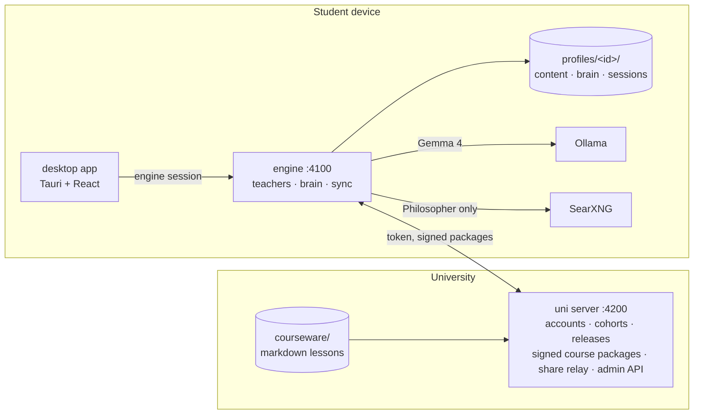

# Saint Elms Fire

## Reimagining learning and knowledge management in the age of AI

Saint Elms Fire is the university of the future. It gives every student their own personal teacher with three minds:

- *Socrates my Friend* is a buddy who knows your logistics and deadlines.
- *Socrates my Guide* knows the syllabus inside out.
- *Socrates my Philosopher* challenges you to apply your knowledge to shape the world.

Together, they teach from a living map of your personal learning journey. Every concept you touch becomes a star, and the constellation of your knowledge grows with you over the course.

Designed around GDPR/DPDP-style data minimisation — a technical posture, not a legal certification — the open-weight models do the work, so the Elms brain runs on your own device. Your knowledge stays under your control, and it is yours to keep forever, long after the course ends.

**In technical terms:** an offline-first study companion with three Socratic AI teachers running on Gemma 4, and a second brain that maps what *you* understand onto your university's course sky.

Submission for [Hacktoberfest Hack Day Bengaluru 2026](https://www.mlh.com/events/hacktoberfest-hack-day-bengaluru-a0), October 13–18, 2026 (tracks: *Best Use of Gemma 4* and *Best Open-Source AI Project*).

**Team The Org of Fine & Curious Individuals:** [Mahesh Shantaram](https://github.com/thecont1/), [Leharaditya Kumar](https://github.com/Larry8668)

---

## The idea in one minute

A university releases its courseware as signed packages. A student's device downloads only what has been released to their cohort, and from then on everything runs locally:

- **Three teachers** with distinct contracts:
  - **Friend** answers campus questions (fees, hostels, calendars) from the university's support notes only, and refuses to share other students' details.
  - **Guide** is a Socratic tutor that teaches only from the student's released lessons and probes their known misconceptions.
  - **Philosopher** takes ideas into the wider world with web search. Every line is tagged `[course]` or `[web]`, and each answer ends with a "Trailhead" question.
- **A second brain**: one markdown page per concept *as the student understands it*. It's a plain folder you can open in Obsidian, and a model only ever *proposes* edits to it. A deterministic validator decides what lands; mastery (met / shaky / solid) is computed from evidence (quizzes, sessions, flagged misconceptions) and never set by the model.
- **The sky**: a star map of every concept in the released courses. Stars light up as the brain grows: amber for shaky, gold for solid, with aurora lines for connections the student made themselves.
- **A registrar's desk** hosted by the university itself at `/admin`: applications in, enrolment decisions out, students and staff managed, every action audited.

Because the teachers, the brain and the courseware live on the device, a student keeps studying with no network at all. Sign-in works offline too, after one online sign-in.

## Try it in two minutes

```bash
corepack enable && pnpm install
pnpm search:up          # optional: SearXNG web search for the Philosopher (Docker)
ollama pull gemma4:e4b  # the default model for every role
pnpm dev                # uni server :4200, engine :4100, desktop UI :5173
```

Open <http://localhost:5173>. Every demo account uses the password **`harbor-lantern`**.

| Account | Who | What to look at |
| --- | --- | --- |
| `ananya@saintelms.local` | Semester 1, week 6 | Small sky, Mechanics half lit, 4 amber misconceptions (force vs. motion, centrifugal force, μN friction) |
| `brinda@saintelms.local` | End of Semester 3 | Dense, mostly gold sky; her own links from physics to the maths underneath (F = dp/dt → derivative) |
| `chetna@saintelms.local` | Semester 5, thesis prep | Near-complete sky, Philosopher research trails, peer links, one self-correcting shaky node (band gap) |

Staff sign in at the registrar portal the uni hosts itself (`http://localhost:4200/admin`). It needs the Postgres account stack rather than the two-minute demo setup — the exact bootstrap commands are in [HANDOVER.md](HANDOVER.md) §4.

Compare the three students on the same **Mechanics** course to see how one curriculum grows into three different brains.

**Offline test:** stop the uni server (or point Settings → University server at a dead URL), sign out, and sign back in as any student. You land in the app with the badge *Signed in offline* and every lesson, chat and brain page still works.

Full setup, demo script and troubleshooting are in **[HANDOVER.md](HANDOVER.md)**. Coding agents start at **[AGENTS.md](AGENTS.md)**. Deep dives:

- **[docs/agentic-layer.md](docs/agentic-layer.md)**: the teachers and workers, their tools, the chat-turn harness, source attribution, chat history and model providers.
- **[docs/knowledge-graph.md](docs/knowledge-graph.md)**: the course sky, the second brain, mastery rules, the brain-update pipeline and the Sky view.

## Architecture



| Package | Path | Role |
| --- | --- | --- |
| `@sef/shared` | `packages/shared` | Types and contracts shared by every package; `@sef/shared/node` holds crypto and the courseware loader |
| `@sef/uni-server` | `server/uni` | Hono API: auth, cohorts and releases, ed25519-signed course packages, peer-share relay, admin API |
| `@sef/engine` | `engine` | Local runtime: per-profile workspaces, Mastra agents, brain pipeline, course sync, offline sign-in |
| `@sef/desktop` | `apps/desktop` | React 19 + Tailwind 4 UI, also packaged with Tauri 2; the student app |
| `@sef/admin` | `apps/admin` | Registrar/staff portal, built statically and served by the uni at `/admin` |
| courseware | `courseware/` | B.Sc. Physics, Mathematics and Astrophysics programme as markdown lessons with frontmatter |

## Why it fits the tracks

**Best Use of Gemma 4**
- Every role runs on a local Gemma 4 model by default: tutoring with tool calls, structured brain proposals, and **vision** for photos of handwritten notes (Capture).
- Small-model reliability is designed in, not hoped for. Schemas are flat, concept names are passed as enums, lane checks run before the model, and output is validated and repaired deterministically afterwards. Thinking mode is used only where it pays off (brain keeper).
- Plug-and-play: each role can point at Ollama, a university-hosted OpenAI-compatible server, or a hosted API, all set from Settings.

**Best Open-Source AI Project**
- Fully self-hostable: `docker compose up` runs the uni server, SearXNG and the engine; the Ollama profile adds the model.
- No vendor lock-in for data: the brain is a plain markdown vault, and courseware is plain markdown.
- Privacy by design, aligned with GDPR/DPDP data-minimisation (this is an engineering posture, not a compliance certification): the brain, chat history and note photos stay on the student's device. The university sees only accounts, releases and which course versions are installed, never what a student wrote or asked (the only exception is a brain page the student explicitly chooses to share with a classmate).
- Trust is explicit. Course packages are ed25519-signed and hash-checked, and the university key is pinned on first use. Every teacher answer comes with a verification panel listing its sources, tool calls and contract checks.

## Repository commands

```bash
pnpm dev           # everything, with hot reload
pnpm typecheck     # all packages
pnpm test          # node:test suites (uni auth & signing, engine validator, mastery, offline sign-in)
pnpm preflight     # checks tools, models and services on a demo machine
pnpm desktop       # Tauri desktop shell (needs Rust)
pnpm docker:up     # self-hosted stack
pnpm store:up      # optional: MinIO object store for vault sync (docs/object-store.md)
```

Licence: see `LICENSE`.
