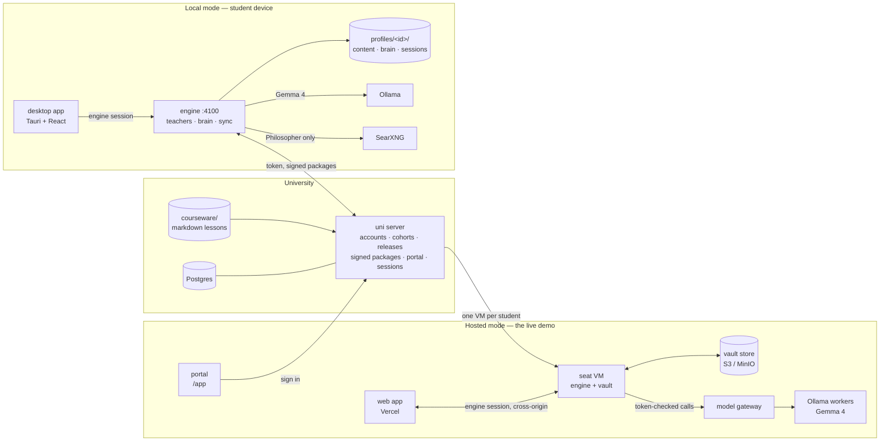

# Saint Elms Fire

## Reimagining learning and knowledge management in the age of AI

Saint Elms Fire is the university of the future. It gives every student their own personal teacher with three minds:

- *Socrates my Friend* is a buddy who knows your logistics and deadlines.
- *Socrates my Guide* knows the syllabus inside out.
- *Socrates my Philosopher* challenges you to apply your knowledge to shape the world.

Together, they teach from a living map of your personal learning journey. Every concept you touch becomes a star, and the constellation of your knowledge grows with you over the course.

Designed around GDPR/DPDP-style data minimisation — a technical posture, not a legal certification — the open-weight models do the work, and the second brain is a plain markdown vault that stays the student's own. Run it fully on the student's device (offline-first), or let the university host each student a private workspace — the vault is exportable byte for byte either way.

**In technical terms:** an offline-first study companion with three Socratic AI teachers on Gemma 4 and a second brain that maps what *you* understand onto the course sky — runnable on a student laptop, or as per-student hosted workspaces behind a university portal.

Submission for [Hacktoberfest Hack Day Bengaluru 2026](https://www.mlh.com/events/hacktoberfest-hack-day-bengaluru-a0), October 13–18, 2026 (tracks: *Best Use of Gemma 4* and *Best Open-Source AI Project*).

**Team The Org of Fine & Curious Individuals:** [Mahesh Shantaram](https://github.com/thecont1/), [Leharaditya Kumar](https://github.com/Larry8668)

---

## See it live

| What | Where |
| --- | --- |
| Portal — sign in, open your workspace | <https://sef-uni.onrender.com/app> |
| Web app — the student workspace itself | <https://saint-elms-fire.vercel.app> |
| Uni API health | <https://sef-uni.onrender.com/health> |

On the portal choose **Sign in as a demo student** — First-, Second- or Third-year — then **Open my workspace**. Each persona is a persistent workspace (its own VM, its own vault) at a different point in the same B.Sc. Physics/Maths/Astrophysics programme. The demo password is private; ask the operator.

| | Ananya | Brinda | Chetna |
| --- | --- | --- | --- |
| Stage | Semester 1, week 6 | End of Semester 3 | Semester 5, thesis prep |
| Sky | 62 lit of 286 | 752 lit of 1,039 | 1,383 lit of 1,773 |
| Story | Mechanics half done; textbook misconceptions open in amber | Strong and well connected; her own physics → maths links | Research mode: Philosopher trails, peer links, a self-correcting misconception |

Two features don't show well on the hosted demo: peer sharing is off on demo accounts (it needs admitted cohorts), and video-link ingestion is blocked by YouTube's bot wall on datacenter IPs — an audio file can always be uploaded instead (video *files* aren't accepted yet, in either mode).

How the hosted path works: the portal sign-in asks the uni for the student's workspace → the uni spawns (or resumes) a **per-student VM** from a golden snapshot → the VM restores the student's vault from the object store → the browser is handed to the web app, which drives that VM cross-origin → every model call goes through a token-checked **model gateway** in front of the Ollama workers. On logout the vault flushes back to the store and the VM is deleted — or kept, for the pinned demo accounts.

## The idea in one minute

A university releases its courseware as signed packages. A student's engine installs only what has been released to their cohort, and from then on everything runs against that engine — on their laptop, or on their own hosted workspace:

- **Three teachers** with distinct contracts:
  - **Friend** answers campus questions (fees, hostels, calendars) from the university's support notes and the student's *confirmed* logistics only, and refuses to share other students' details — the refusal check runs before the model does.
  - **Guide** is a Socratic tutor that teaches only from the student's released lessons and probes their known misconceptions.
  - **Philosopher** takes ideas into the wider world with web search, anchored in a page of the student's own wiki. Every line is tagged `[course]` or `[web]`, and each answer ends with a "Trailhead" question.
- **A second brain**: one markdown page per concept *as the student understands it* — a plain folder you can open in Obsidian. Models only ever *propose* edits; a deterministic compiler and merge policy decide what lands, nothing writes until the student reviews a diff, and mastery (met / shaky / solid) is computed from evidence, never set by the model.
- **The sky**: a star map of every concept in the released courses plus the student's own syntheses and questions. Stars light up as the brain grows: amber for shaky, gold for solid, aurora lines for connections the student made themselves.
- **Add to my wiki**: any evidence becomes a source — pasted or written notes, a PDF, a photo of handwritten notes (read by the vision model), a voice memo or lecture recording (transcribed with timestamps), or a consent-gated video link (local mode — video sites block datacenter IPs). Extractions can be corrected; every compile ends in an explicit proposal review.
- **Peers**: publish a page to your cohort's feed; importing a share runs the same source → proposal → review pipeline, never a direct write. An advisory safety screen flags risky payloads — the student still decides.
- **Proactive, within limits**: an attention rail, suggested questions from recent work, bounded study plans and consented subject feeds — all derived from the student's own stores, no silent writes.
- **A registrar's desk** hosted by the university itself at `/admin`: applications in, enrolment decisions out, every staff action audited.

In local mode the teachers, the brain and the courseware live on the device, so a student keeps studying with no network at all — sign-in works offline too, after one online sign-in. In hosted mode the same engine runs on a per-student VM: reads and vault export keep working even if the student's access lapses.

## Try it locally in two minutes

```bash
corepack enable && pnpm install
pnpm ollama:pull        # gemma4:e4b + embeddinggemma + shieldgemma:2b
pnpm search:up          # optional: SearXNG web search for the Philosopher (Docker)
pnpm dev                # uni server :4200, engine :4100, desktop UI :5173
```

Open <http://localhost:5173>. Every local demo account uses the password **`harbor-lantern`**.

| Account | Who | What to look at |
| --- | --- | --- |
| `ananya@saintelms.local` | Semester 1, week 6 | Small sky, Mechanics half lit, 4 amber misconceptions (force vs. motion, centrifugal force, μN friction) |
| `brinda@saintelms.local` | End of Semester 3 | Dense, mostly gold sky; her own links from physics to the maths underneath (F = dp/dt → derivative) |
| `chetna@saintelms.local` | Semester 5, thesis prep | Near-complete sky, Philosopher research trails, peer links, one self-correcting shaky node (band gap) |

Staff sign in at the registrar portal the uni hosts itself (`http://localhost:4200/admin`). It needs the Postgres account stack rather than the two-minute demo setup — the exact bootstrap commands are in [HANDOVER.md](HANDOVER.md) §4.

Compare the three students on the same **Mechanics** course to see how one curriculum grows into three different brains.

**Offline test:** stop the uni server (or point Settings → University server at a dead URL), sign out, and sign back in as any student. You land in the app with the badge *Signed in offline* and every lesson, chat and brain page still works.

Full setup, demo script and troubleshooting are in **[HANDOVER.md](HANDOVER.md)**. Coding agents start at **[AGENTS.md](AGENTS.md)**. Deep dives:

- **[docs/agentic-layer.md](docs/agentic-layer.md)**: the teachers, their tools, the chat-turn harness, source attribution, chat history and model providers.
- **[docs/knowledge-graph.md](docs/knowledge-graph.md)**: the course sky, the second brain, mastery rules, the brain-update pipeline and the Sky view.
- **[docs/hosted-seat.md](docs/hosted-seat.md)** and **[docs/session-orchestrator.md](docs/session-orchestrator.md)**: running the engine on a public URL, and how the uni spawns, leases, suspends and retires per-student VMs.
- **[docs/model-gateway.md](docs/model-gateway.md)**: the authenticated, load-balanced gateway hosted engines use instead of a local Ollama.
- **[docs/object-store.md](docs/object-store.md)**: the S3-compatible vault store (manifest sync, tombstones, compare-and-swap).
- **[docs/deploy-render.md](docs/deploy-render.md)** / **[docs/deploy-vercel.md](docs/deploy-vercel.md)**: the hosted demo's deploy paths.

## Architecture



| Package | Path | Role |
| --- | --- | --- |
| `@sef/shared` | `packages/shared` | Types and contracts shared by every package; `@sef/shared/node` holds crypto and the courseware loader |
| `@sef/uni-server` | `server/uni` | Hono API: auth, cohorts and releases, ed25519-signed course packages, peer-share feed, session orchestration, admin API |
| `@sef/gateway` | `server/gateway` | Token-checked, load-balanced proxy in front of Ollama/OpenAI-compatible workers for hosted engines |
| `@sef/engine` | `engine` | Student runtime: per-profile workspaces, Mastra agents, brain pipeline, course sync, chat history, offline sign-in, vault store sync |
| `@sef/desktop` | `apps/desktop` | React 19 + Tailwind 4 UI, also packaged with Tauri 2; builds the student app and the uni-hosted portal shell |
| `@sef/admin` | `apps/admin` | Registrar/staff portal, built statically and served by the uni at `/admin` |
| courseware | `courseware/` | B.Sc. Physics, Mathematics and Astrophysics programme as markdown lessons with frontmatter |
| seat infra | `infra/seat/` | Seat bootstrap, session start/stop scripts, golden-snapshot build for hosted VMs |
| e2e | `e2e/` | Playwright release drill against a real uni + engine, no mocks |

## Why it fits the tracks

**Best Use of Gemma 4**
- Every role runs on a Gemma model by default: tutoring with tool calls, structured brain proposals, **vision** for photos of handwritten notes, embeddings for hybrid retrieval, and ShieldGemma as an advisory safety screen on peer shares — with hardware-tiered suggestions so the models match the machine.
- Small-model reliability is designed in, not hoped for. Schemas are flat, concept names are passed as enums, lane checks run before the model, and output is validated and repaired deterministically afterwards. Thinking mode is used only where it pays off (brain keeper).
- Plug-and-play: each role can point at Ollama, a university-hosted OpenAI-compatible server (the model gateway on hosted seats), or a hosted API — all from Settings.

**Best Open-Source AI Project**
- Fully self-hostable: `docker compose up` runs the uni server, SearXNG and the engine; the Ollama profile adds the models.
- No vendor lock-in for data: the brain is a plain markdown vault with one-command export/import, and courseware is plain markdown.
- Privacy by design, aligned with GDPR/DPDP data-minimisation (an engineering posture, not a compliance certification): in local mode the brain, chat history and note photos never leave the device; in hosted mode each student's vault lives on their own VM and store prefix, and source erasure is supported end to end. The university sees accounts, releases and which course versions are installed — never what a student wrote or asked, except a brain page the student explicitly chooses to share with a classmate.
- Trust is explicit. Course packages are ed25519-signed and hash-checked, and the university key is pinned on first use. Every teacher answer comes with a verification panel listing its sources, tool calls and contract checks.

## Repository commands

```bash
pnpm dev           # everything, with hot reload (uni :4200, engine :4100, UI :5173)
pnpm typecheck     # all packages
pnpm test          # node:test suites (uni auth & signing, engine validator, mastery, offline auth)
pnpm test:e2e      # Playwright release drill against a real uni + engine
pnpm eval          # engine agent-eval scenario runner
pnpm preflight     # checks tools, models and services on a demo machine
pnpm build:hosted  # the /app portal + /admin bundles the uni serves
pnpm dev:gateway   # model gateway alone
pnpm docker:up     # self-hosted stack
pnpm search:up     # optional SearXNG for the Philosopher
pnpm store:up      # optional: MinIO object store for vault sync (docs/object-store.md)
pnpm ollama:pull   # gemma4:e4b + embeddinggemma + shieldgemma:2b
pnpm desktop       # Tauri desktop shell (needs Rust)
```

Licence: see `LICENSE`.
