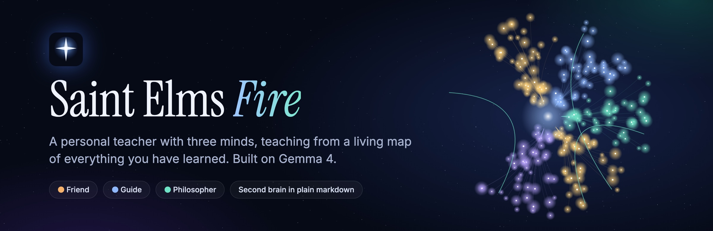
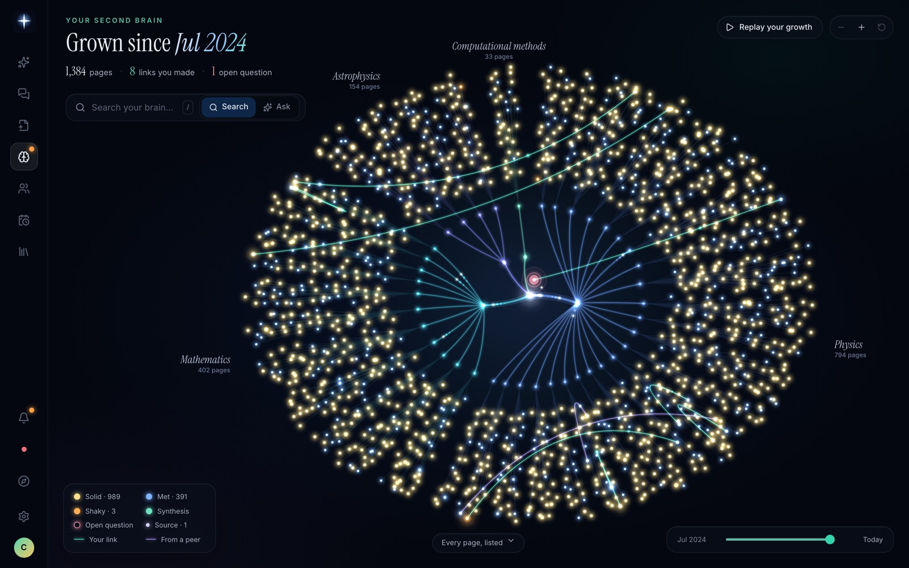
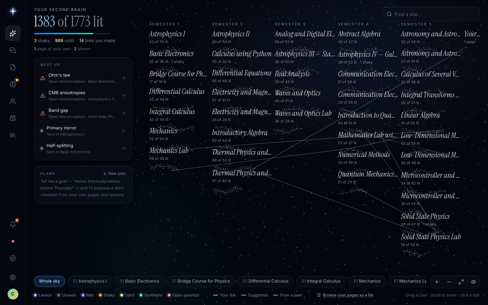
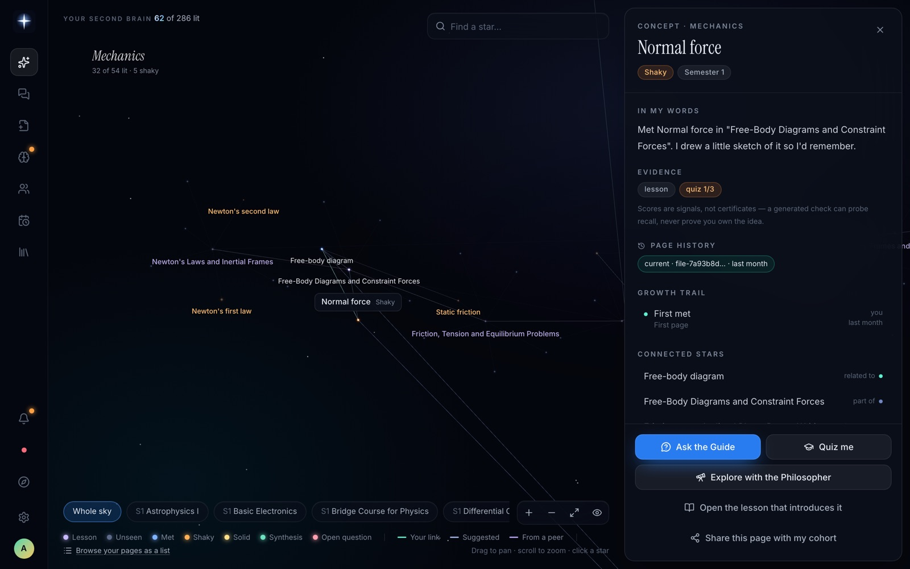
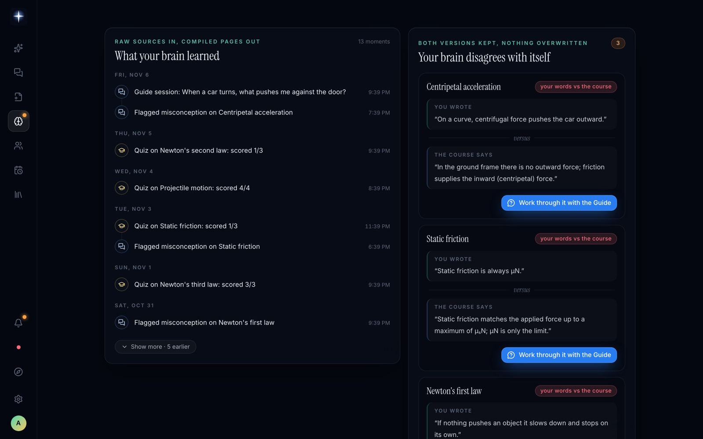
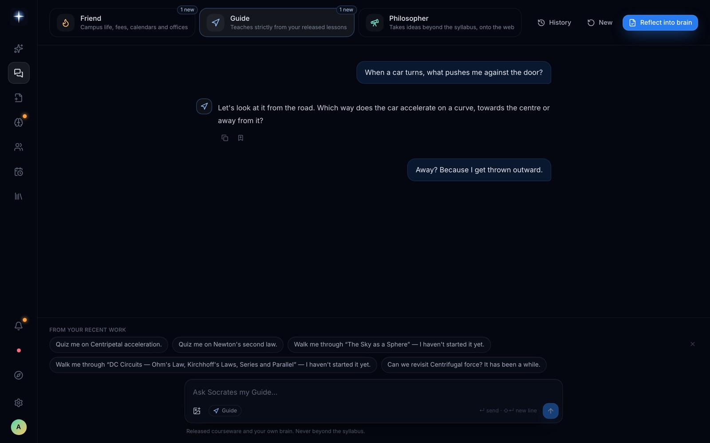
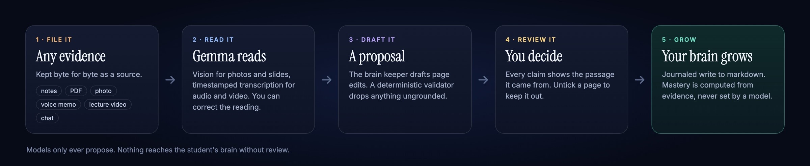
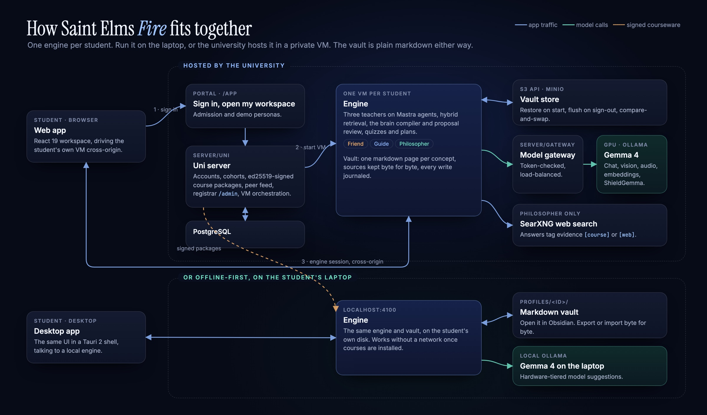

<p align="center">
  
</p>

<p align="center">
  <a href="docs/gemma-and-multimodal.md"></a>
  <a href="docs/gemma-and-multimodal.md"></a>
  <a href="docs/features.md#offline-and-hosted"></a>
  <a href="LICENSE"></a>
</p>

<p align="center">
  <a href="docs/features.md"><b>Features</b></a> ·
  <a href="docs/getting-started.md"><b>Run it locally</b></a> ·
  <a href="docs/live-demo.md"><b>Hosted demo</b></a> ·
  <a href="docs/architecture.md"><b>Architecture</b></a> ·
  <a href="docs/gemma-and-multimodal.md"><b>Gemma &amp; multimodal</b></a> ·
  <a href="HANDOVER.md"><b>Handover</b></a>
</p>

---

**Saint Elms Fire is the university of the future.** Every student gets a personal teacher with three minds. Together they teach from a living map of that student's learning: every concept they touch becomes a star, and the constellation grows with them through the course.

The models are open-weight Gemma 4. The second brain is a plain markdown vault that stays the student's own. It runs fully on a student's laptop, or the university hosts each student a private workspace, and the vault exports byte for byte either way.

<p align="center">
  
  <br><sub>A third-year student's second brain: 1,384 pages across physics, mathematics and astrophysics.</sub>
</p>

## Three minds

| | Mind | What it does |
| :---: | --- | --- |
| 🔥 | **Socrates my Friend** | Knows your campus: fees, hostels, calendars and your confirmed deadlines. Never shares another student's details. |
| 🧭 | **Socrates my Guide** | Knows the syllabus inside out and teaches only from your released lessons, probing the misconceptions you actually hold. |
| 🔭 | **Socratest my Philosopher** | Starts from a page of your own wiki and takes it onto the web, to real-world applications and recent developments. Every claim is tagged `[course]` or `[web]`. |

## What makes it different

- **Your brain, in your words.** One markdown page per concept, as *you* understand it. Open the folder in Obsidian.
- **Models only propose.** Gemma drafts page edits; a deterministic compiler decides what may land, and you review the diff before anything is written.
- **Mastery is earned.** Met, shaky and solid are computed from evidence, never set by a model.
- **Contradictions stay visible.** When your words and the course disagree, both are kept and the Guide helps you work through it.
- **Works offline.** With local models, courses, chat and the brain keep working without a network.

## A look inside

<table>
  <tr>
    <td width="50%"><br><b>The sky.</b> Every concept in the released courses. Gold is solid, amber is shaky, aurora lines are links you made.</td>
    <td width="50%"><br><b>A concept.</b> Your words, the evidence behind its status, and one click to the Guide, a quiz or the Philosopher.</td>
  </tr>
  <tr>
    <td width="50%"><br><b>What your brain learned.</b> A timeline of sources compiled into pages, and the places your brain disagrees with itself.</td>
    <td width="50%"><br><b>The Guide.</b> Socratic by design: it answers a question with the question that gets you there.</td>
  </tr>
</table>

More in **[Features](docs/features.md)**.

## From any evidence to your brain

Notes, PDFs, photos of handwritten pages, voice memos and lecture videos all go through the same reviewed pipeline.

<p align="center">
  
</p>

How each format is read, and why every model role is a Gemma: **[Gemma &amp; multimodal](docs/gemma-and-multimodal.md)**.

## How it fits together

<p align="center">
  
</p>

Packages, the hosted flow and the deep dives: **[Architecture](docs/architecture.md)**.

## Quick start

```bash
corepack enable && pnpm install
cp .env.example .env
pnpm ollama:pull     # gemma4:e4b + embeddinggemma + shieldgemma:2b
pnpm dev             # uni :4200 · engine :4100 · web UI :5173
```

Open <http://localhost:5173>, choose **Exploring the demo?** and pick a student. Prerequisites, the three demo students, the offline drill and every command are in **[Getting started](docs/getting-started.md)**.

## Documentation

| | |
| --- | --- |
| [Features](docs/features.md) | The teachers, the second brain, the sky, Add to my wiki, Peers and the registrar |
| [Getting started](docs/getting-started.md) | Run it locally, demo students, offline test, repository commands |
| [Hosted demo](docs/live-demo.md) | The deployed portal and web app, and how a hosted workspace starts |
| [Architecture](docs/architecture.md) | Diagram, packages and links to every deep dive |
| [Gemma &amp; multimodal](docs/gemma-and-multimodal.md) | Model roles, how each format is read, open-source and privacy posture |
| [HANDOVER.md](HANDOVER.md) | The operator runbook: setup, demo script, auth, troubleshooting |
| [AGENTS.md](AGENTS.md) | Start here before changing code |

## Built at Hacktoberfest Hack Day Bengaluru 2026

A submission for [Hacktoberfest Hack Day Bengaluru 2026](https://www.mlh.com/events/hacktoberfest-hack-day-bengaluru-a0), October 13–18, 2026, in **Track 1: Best Use of Gemma 4 → G3. Multimodal AI Intelligence**.

**Team The Org of Fine & Curious Individuals:** [Mahesh Shantaram](https://github.com/thecont1/) and [Leharaditya Kumar](https://github.com/Larry8668).

Licensed under [Apache 2.0](LICENSE).
