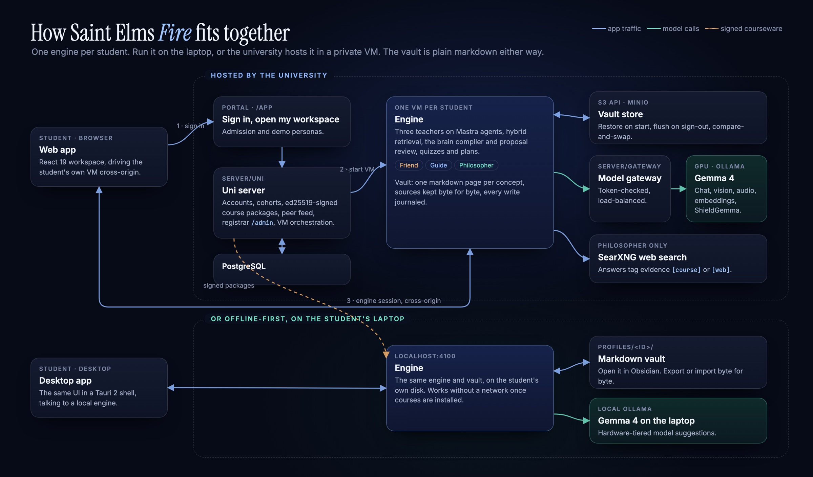
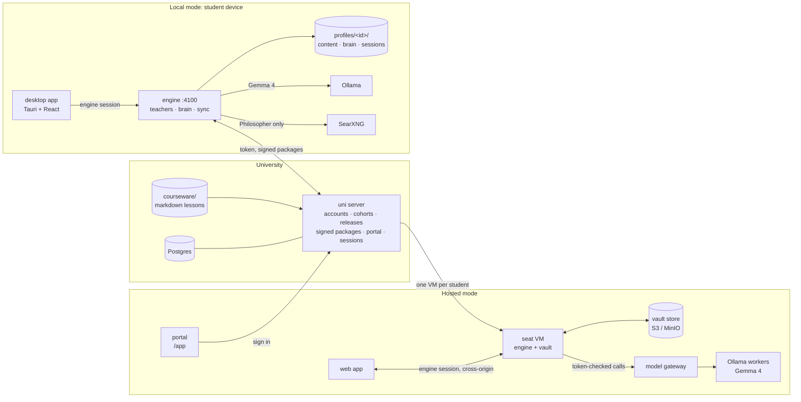

# Architecture

[← Back to the README](../README.md)

Every student gets their own engine. It runs either on the student's laptop, offline-first, or in a private VM the university hosts. The engine holds the three teachers, the brain compiler and the student's vault, which is plain markdown in both cases.

## Hosted mode

1. **Sign in.** The student signs in at the portal, which the uni server hosts at `/app`.
2. **Start a VM.** The uni starts or resumes a per-student VM from a golden snapshot.
3. **Restore the vault.** The VM restores the student's vault from an S3-compatible store and flushes it back on sign-out.
4. **Hand off.** The browser is handed to the web app, which talks to that VM's engine cross-origin.
5. **Call models.** Every model call goes through a token-checked, load-balanced gateway in front of Ollama workers running Gemma 4.
6. **Search.** The Philosopher alone calls SearXNG for web search.

## Local mode

The desktop app, a Tauri 2 shell around the same React UI, talks to an engine on `localhost:4100`. The engine stores each profile under `profiles/<id>/` and calls a local Ollama. It still syncs signed course packages from the uni, and keeps working without a network once courses are installed.

## Diagram source

The image above is hand-drawn. This Mermaid version carries the same structure and renders on GitHub.

## Packages

| Package | Path | Role |
| --- | --- | --- |
| `@sef/shared` | `packages/shared` | Types and contracts shared by every package; `@sef/shared/node` holds crypto and the courseware loader |
| `@sef/uni-server` | `server/uni` | Hono API: auth, cohorts and releases, ed25519-signed course packages, peer-share feed, session orchestration, admin API |
| `@sef/gateway` | `server/gateway` | Token-checked, load-balanced proxy in front of Ollama or OpenAI-compatible workers for hosted engines |
| `@sef/engine` | `engine` | Student runtime: per-profile workspaces, Mastra agents, brain pipeline, course sync, chat history, offline sign-in, vault store sync |
| `@sef/desktop` | `apps/desktop` | React 19 + Tailwind 4 UI, also packaged with Tauri 2; builds the student app and the uni-hosted portal shell |
| `@sef/admin` | `apps/admin` | Registrar and staff portal, built statically and served by the uni at `/admin` |
| courseware | `courseware/` | B.Sc. Physics, Mathematics and Astrophysics programme as markdown lessons with frontmatter |
| seat infra | `infra/seat/` | Seat bootstrap, session start and stop scripts, golden-snapshot build for hosted VMs |
| e2e | `e2e/` | Playwright release drill against a real uni and engine, no mocks |

## Deep dives

| Topic | Document |
| --- | --- |
| The teachers, their tools, the chat-turn harness, source attribution and model providers | [agentic-layer.md](agentic-layer.md) |
| The course sky, the second brain, mastery rules and the brain-update pipeline | [knowledge-graph.md](knowledge-graph.md) |
| Running the engine on a public URL | [hosted-seat.md](hosted-seat.md) |
| How the uni spawns, leases, suspends and retires per-student VMs | [session-orchestrator.md](session-orchestrator.md) |
| The authenticated, load-balanced model gateway | [model-gateway.md](model-gateway.md) |
| The S3-compatible vault store: manifest sync, tombstones, compare-and-swap | [object-store.md](object-store.md) |
| Deploying the uni, gateway, search and store on Render | [deploy-render.md](deploy-render.md) |
| Deploying the web app on Vercel | [deploy-vercel.md](deploy-vercel.md) |
