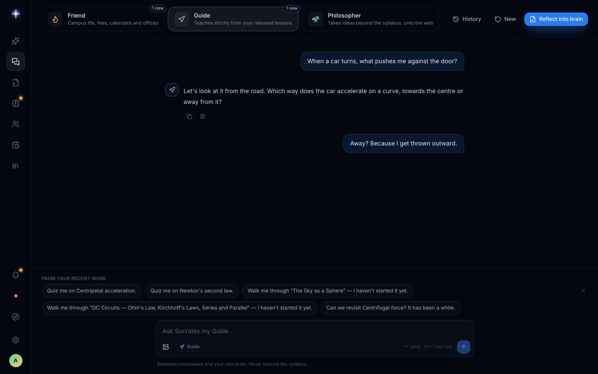
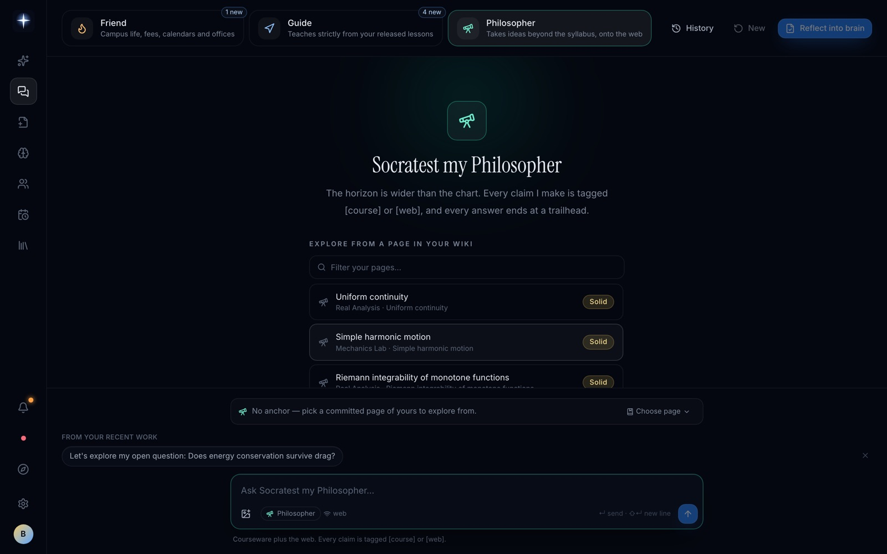
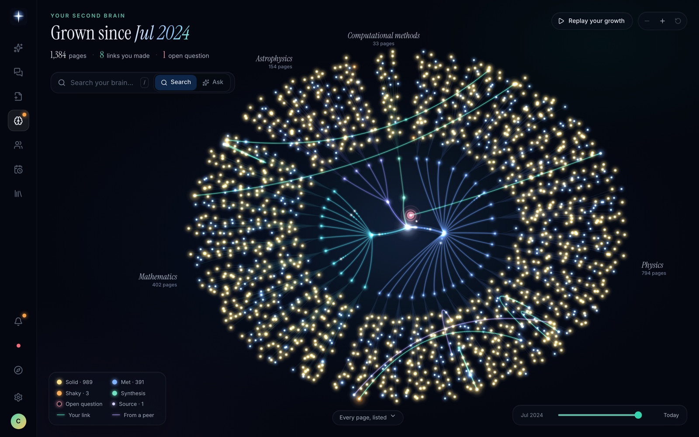
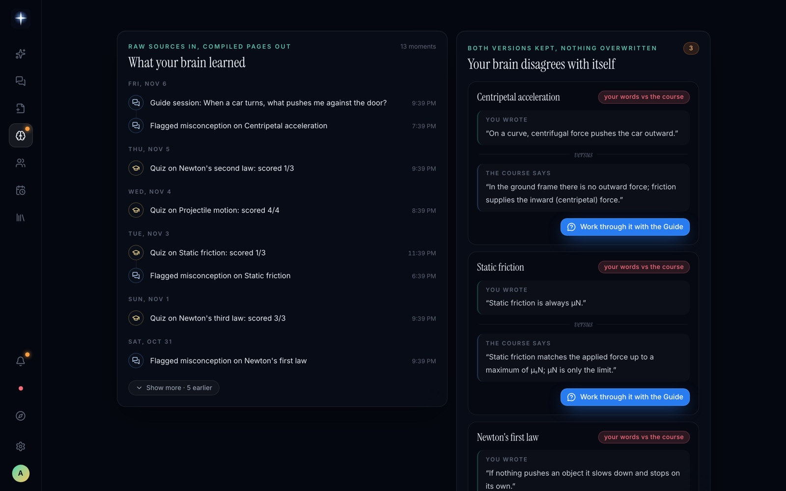
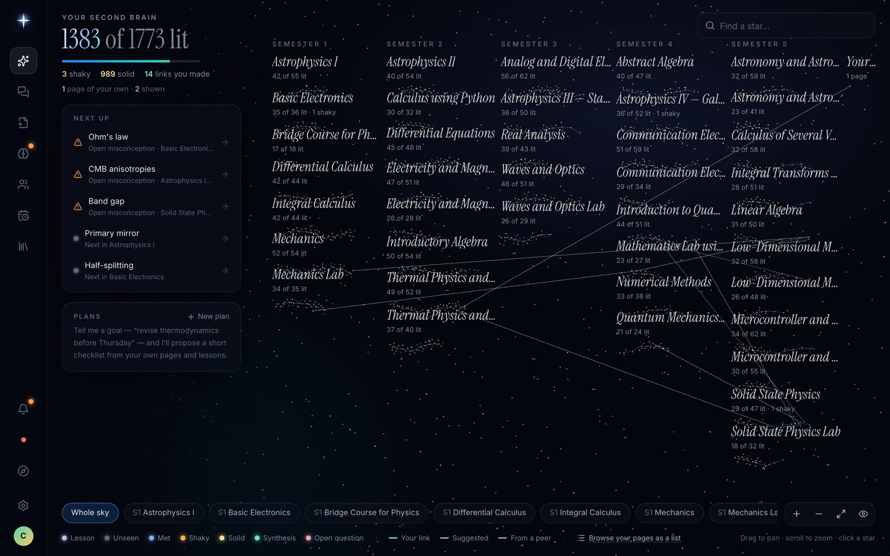
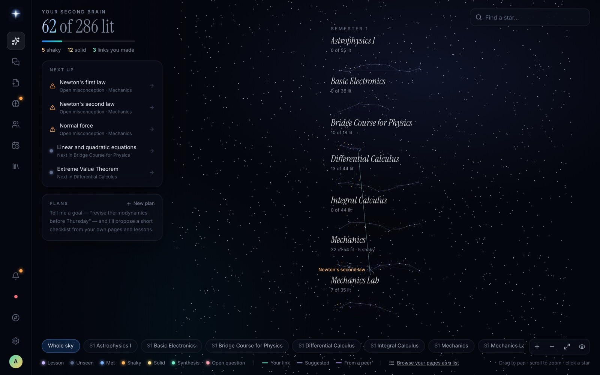
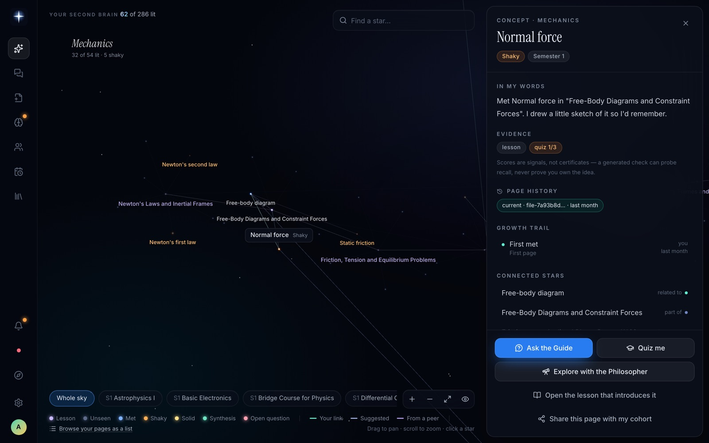
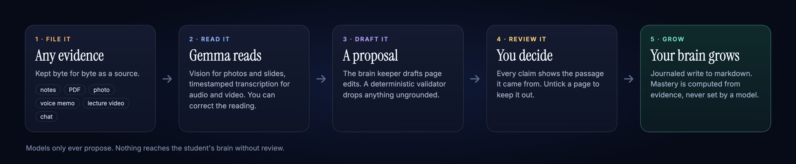
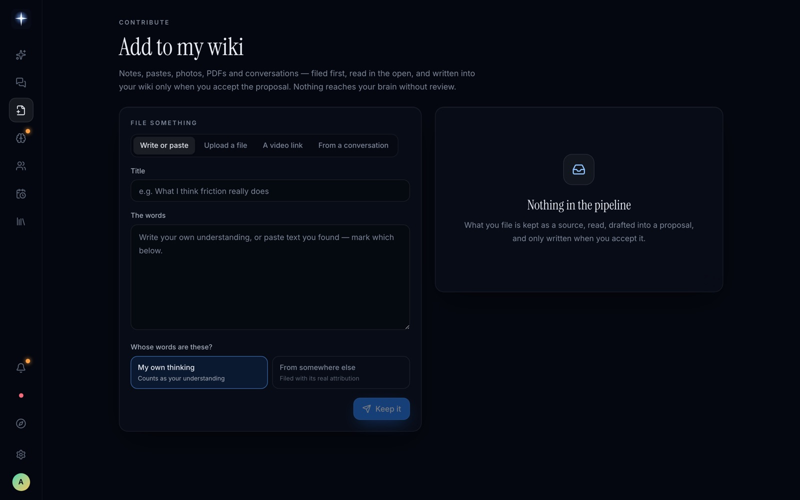
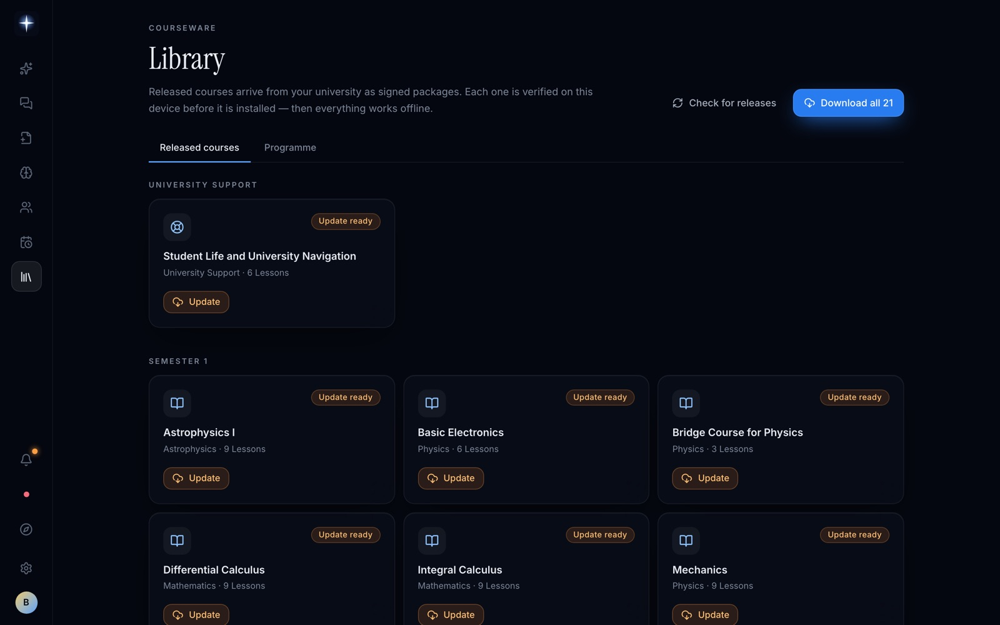

# Features

[← Back to the README](../README.md)

A university releases its courseware as signed packages. A student's engine installs only what has been released to their cohort. From then on everything runs against that engine, either on their laptop or in their own hosted workspace.

- [Three teachers](#three-teachers)
- [The second brain](#the-second-brain)
- [The Brain view](#the-brain-view)
- [The sky](#the-sky)
- [Add to my wiki](#add-to-my-wiki)
- [Peers](#peers)
- [Proactive, within limits](#proactive-within-limits)
- [The registrar's desk](#the-registrars-desk)
- [Offline and hosted](#offline-and-hosted)

---

## Three teachers

Each teacher has its own contract. The contract decides what it may read and what it may say.

| | Teacher | What it does |
| --- | --- | --- |
| 🔥 | **Socrates my Friend** | Answers campus questions such as fees, hostels and calendars. It uses the university's support notes and the student's *confirmed* logistics only. It refuses to share other students' details, and that refusal check runs before the model does. |
| 🧭 | **Socrates my Guide** | A Socratic tutor that teaches only from the student's released lessons and probes their known misconceptions. |
| 🔭 | **Socratest my Philosopher** | Starts from a committed, course-linked page of the student's wiki and explores real-world applications and recent developments. Web search runs on every turn and the anchor bar shows the query. Answers tag evidence as `[course]` or `[web]` and end with a `Trailhead:` question. Without search it falls back to course evidence. |

Every answer comes with a verification panel listing its sources, tool calls and contract checks.

  
  

## The second brain

The brain is one markdown page per concept, written *as the student understands it*. It is a plain folder that opens in Obsidian.

- **Models only propose.** A deterministic compiler and merge policy decide what lands.
- **Drafts wait for review.** Model-drafted edits wait for the student to review a diff.
- **Mastery is computed.** Met, shaky and solid come from evidence, never from the model.
- **Nothing is overwritten.** When the student's words and the course disagree, both versions are kept and surfaced.

## The Brain view

A full-screen, interactive map of the student's wiki. It grows from the first page they wrote, and a replay shows that growth over time.

- **Search** lights the matching pages and dims the rest.
- **Ask your brain** answers from the student's own wiki only. It highlights the cited pages and can save an answer through proposal review.
- **See it in your brain** follows an accepted proposal. The new pages bloom into the map, light up, and are named in a banner.
- **Scroll down** for *What your brain learned*, *Your brain disagrees with itself*, page provenance, sources and maintenance.

## The sky

A star map of every concept in the released courses, plus the student's own syntheses and questions. Stars light up as the brain grows. Amber means shaky, gold means solid, and aurora lines are connections the student made themselves.

Click a star to open its concept sheet. It shows the page in the student's words, the evidence behind its status, its history and its connections. From there the student can ask the Guide, take a quiz, explore with the Philosopher or share the page.

  
  

## Add to my wiki

Any evidence becomes a source, kept byte for byte.

- **Text:** pasted or written notes, and PDFs read page by page with honest partial results.
- **Images:** a photo of handwritten notes or a campus notice, read on upload by the vision model.
- **Audio:** a voice memo or lecture recording, transcribed in timestamped windows.
- **Video:** an uploaded lecture video. The audio is transcribed and sampled slide or board frames are read, merged on timestamps.
- **Conversations:** a frozen chat session.
- **YouTube:** a consented fetch. Video sites can block datacenter IPs, so upload the file instead when it matters.

Audio and video are read in the background. The student can correct an extraction before anything is drafted, and every proposed page change waits for explicit review.

## Peers

A student can publish a page to their cohort's feed. Importing a share runs the same source, proposal and review pipeline, never a direct write. An advisory ShieldGemma screen flags risky payloads, and the student still decides.

## Proactive, within limits

An attention rail, suggested questions from recent work, bounded study plans and consented subject feeds. All of it is derived from the student's own stores, with no silent writes.

## The registrar's desk

The university hosts a staff portal at `/admin`. Applications come in, enrolment decisions go out, and every staff action is audited.

## Offline and hosted

With local model providers, the engine, brain and installed courseware keep working without a network. Local sign-in uses a cached password verifier or a retained signed entitlement, depending on the account flow ([HANDOVER.md](../HANDOVER.md) §6).

Hosted mode needs the network. A limited session still permits reads and vault export. See [Architecture](architecture.md) for how hosted workspaces are provisioned.
