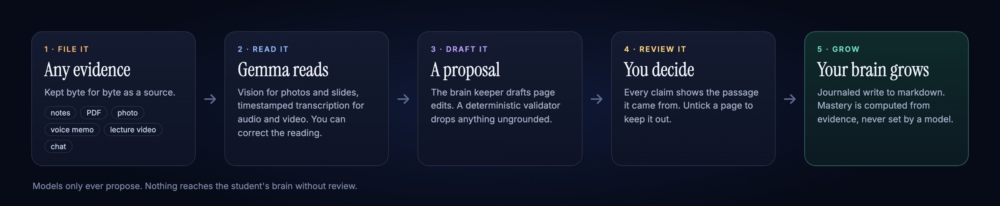

# Gemma 4 and multimodal intelligence

[← Back to the README](../README.md)

Saint Elms Fire was built for [Hacktoberfest Hack Day Bengaluru 2026](https://www.mlh.com/events/hacktoberfest-hack-day-bengaluru-a0), **Track 1: Best Use of Gemma 4 → G3. Multimodal AI Intelligence**, which asks for something that *"combines information such as text, images or audio to understand context and produce meaningful outcomes"*.

## One pipeline for every format

The product *is* the multimodal pipeline the track asks for. Every input format a student hands it becomes a first-class source in one reasoning system, and every model that touches it is a Gemma by default.

| Format | How it is read |
| --- | --- |
| **Images** | A photo of handwritten notes or a campus notice is read on upload by the vision-role Gemma through native `/api/chat`. A photographed notice can become a logistics proposal the Friend later cites. |
| **Audio** | A voice memo or recorded lecture is normalised with ffmpeg and transcribed in timestamped windows through the vision-role provider's `/v1/audio/transcriptions`. |
| **Video** | An uploaded lecture video (MP4, MOV, WebM, MKV) is read in the background. The audio track is transcribed and at most 12 sampled slide or board frames are read by the vision model, merged on timestamps into one extraction. A pasted YouTube link stays a separate, consent-gated fetch. |
| **Text** | Pasted or written notes, PDFs read page by page with honest partial results, and frozen chat sessions. |

All of it flows through one deterministic *extract → compile → proposal → student review* pipeline. A single teacher answer can draw on a released lesson, a photographed notice and a lecture recording, and every citation is verified before it is shown.

## Every role is a Gemma

| Role | Model | Job |
| --- | --- | --- |
| Tutor | Gemma 4 | Tool-calling chat for the three teachers |
| Brain keeper | Gemma 4 | Structured page-edit proposals |
| Vision | Gemma 4 | Images, slides and audio |
| Embed | EmbeddingGemma | Hybrid retrieval |
| Safety | ShieldGemma | Advisory peer-share screening |

Hardware-tiered suggestions match the models to the machine. Each role can be switched between Ollama, the hosted model gateway, or any OpenAI-compatible API, all from Settings.

## Small-model reliability, by design

- **Flat schemas.** Concept names are passed as enums, so a small model cannot invent one.
- **Checks before the model.** Lane checks, such as the Friend's privacy refusal, run first.
- **Repair after the model.** Output is validated and repaired deterministically.
- **Thinking where it pays.** Thinking mode defaults on for local profiles' brain keeper and off on central-model seats (`ENGINE_THINKING_DEFAULT=false`). These are first-run defaults; stored profile settings win.

## Open source, and the student's own data

- **Self-hostable.** The compose stack covers PostgreSQL, the uni server, the engine and SearXNG, with optional profiles for Mailpit, MinIO, Ollama and the gateway. Production env and migrations are in [HANDOVER.md](../HANDOVER.md) §3; a plain `docker compose up` is not the production path.
- **No lock-in.** The brain is a plain markdown vault with one-command export and import, and courseware is plain markdown.
- **Local or university-hosted.** With local providers and analytics disabled, study data can stay on the student's device. Hosted workspaces and inference are operated by the university, whose operator can access the VM and store. Sharing, web search, external model providers and optional PostHog analytics have their own network paths.
- **Explicit trust.** Course packages are ed25519-signed and hash-checked, and the university key is pinned on first use. Every teacher answer carries a verification panel listing its sources, tool calls and contract checks.

The design follows GDPR- and DPDP-style data minimisation. It is a technical posture, not a legal certification.
