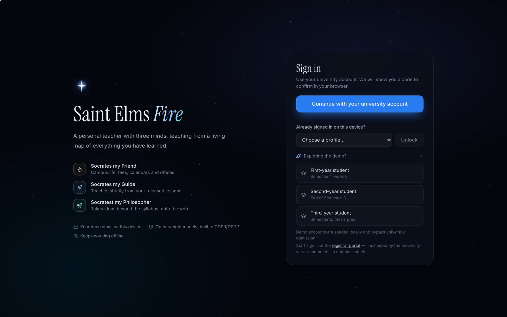

# The hosted demo

[← Back to the README](../README.md)

> [!IMPORTANT]
> The hosted demo was paused after the hack day to save credits. The web app still loads, but the portal and the student workspaces are offline until the services are resumed. To try Saint Elms Fire now, [run it locally](getting-started.md).

| What | Where |
| --- | --- |
| Portal: sign in and open your workspace | <https://sef-uni.onrender.com/app> |
| Web app: the student workspace itself | <https://saint-elms-fire.vercel.app> |
| Uni API health | <https://sef-uni.onrender.com/health> |

These are the configured demo entry points. Repository updates and deployed revisions are separate.

## Signing in

On a self-serve demo build, choose a student under **Try the demo**. The portal opens that student's workspace, signs in there and starts the guided tour. Close the tour with × or Esc; **Tour** above Settings restarts it.

If self-serve is disabled, use **Sign in as a demo student**, enter the operator-provided password, then **Open my workspace** and sign in on that engine.

A self-serve build embeds the demo password in the public portal bundle on purpose. It is only ever the demo credential ([deploy-vercel.md](deploy-vercel.md)).

## The three students

They share the same B.Sc. Physics, Mathematics and Astrophysics programme at different stages. Each student has one persistent workspace shared by everyone trying that student. Each browser gets its own engine session.

| | Ananya | Brinda | Chetna |
| --- | --- | --- | --- |
| **Stage** | Semester 1, week 6 | End of Semester 3 | Semester 5, thesis prep |
| **Sky** | Early course concepts and open misconceptions | Dense course sky with student-made connections | Advanced concepts, syntheses and research questions |
| **Story** | Mechanics half done; textbook misconceptions open in amber | Strong and well connected; her own physics → maths links | Research mode: Philosopher trails, peer links, a self-correcting misconception |

## Good to know

- **Peers** work when demo admission rows are seeded in Postgres. Each student is in a different cohort, so switching students does not show the same feed.
- **Video files** are supported. The engine combines audio transcription with sampled slide and board frames.
- **YouTube links** can be blocked on datacenter IPs. Upload an audio or video file instead.
- **Signing out** requests a final vault flush and ends the workspace. Ordinary workspaces are retired; pinned demo workspaces remain. Engine logout revokes only the calling device's session.

## How the hosted path works

1. Portal sign-in asks the uni for the student's workspace.
2. The uni starts or resumes a **per-student VM** from a golden snapshot.
3. The VM restores the student's vault from the object store.
4. The browser is handed to the web app, which drives that VM cross-origin.
5. Every model call goes through a token-checked **model gateway** in front of the Gemma workers.

See [Architecture](architecture.md) for the full picture, and [deploy-render.md](deploy-render.md) and [deploy-vercel.md](deploy-vercel.md) for the deploy paths.
